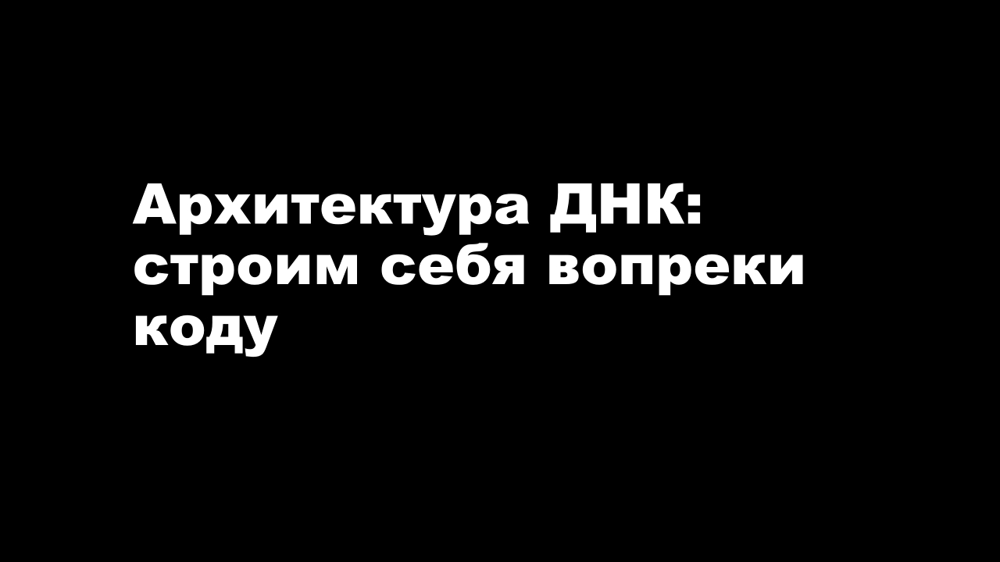
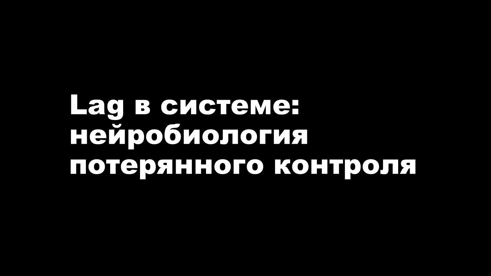
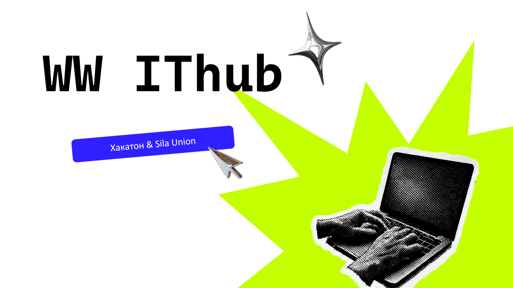
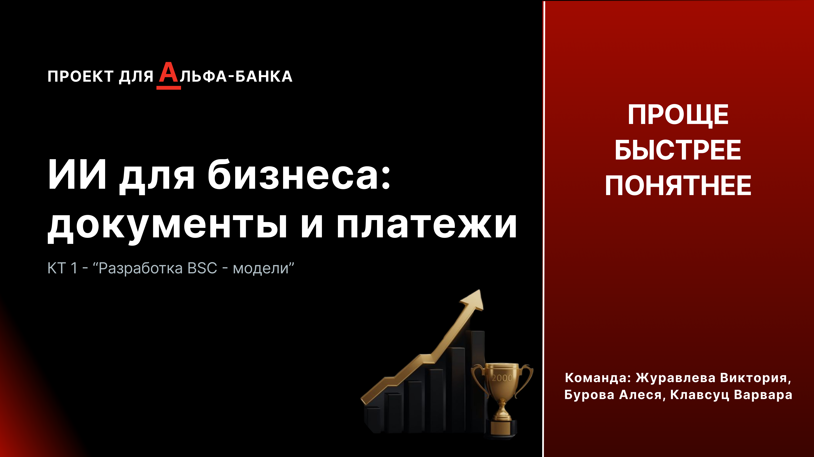

<div align="center">

# 📊 Presentation Templates & Decks Hub

Коллекция авторских презентаций и шаблонов для публичных выступлений, хакатонов и стратегического бизнеса.

[](https://www.figma.com)
[](https://microsoft.com/powerpoint)
[](LICENSE)
[](#-каталог-презентаций)

</div>

---

## 🧭 Навигация по категориям

* [🔬 Научно-популярные выступления (TED / Science)](#-научно-популярные-выступления-ted--science)
* [⚡ Хакатоны и бизнес-кейсы (Problem Solving)](#-хакатоны-и-бизнес-кейсы-problem-solving)
* [📈 Стратегический менеджмент и BSC](#-стратегический-менеджмент-и-бизнес-модели)

---

## 📌 Каталог презентаций

### 🔬 Научно-популярные выступления (TED / Science)

> Лаконичные, визуально насыщенные слайды для живых выступлений, питчей и лекций с акцентом на сторителлинг и визуализацию сложных концепций. В них практически отсутствует текст, но хорошо переданы эмоции.

| Превью | Описание темы | Формат и ссылки |
| :--- | :--- | :--- |
|  | **🧬 Генетика: Код жизни и будущее биотеха**<br><br>• Формат: 16:9 (TED Talks style)<br>• Минималистичная инфографика ДНК, мутаций и биоинформатики<br>• Чистая типографика без перегруза текстом | 📥 [Скачать .pptx](decks/01-genetics-ted-talk/genetics_presentation.pptx)<br>📂 [Папка проекта](./decks/01-genetics-ted-talk/) |
|  | **🧠 Нейробиология: Архитектура мышления**<br><br>• Формат: 16:9 (Public Speaking)<br>• Иллюстрации нейронных связей, когнитивных паттернов и восприятия<br>• Акцентные контрастные слайды под темный зал | 📥 [Скачать .pptx](decks/02-neurobiology-ted-talk/neurobiology_presentation.pptx)<br>📂 [Папка проекта](./decks/02-neurobiology-ted-talk/) |

---

### ⚡ Хакатоны и бизнес-кейсы (Problem Solving)

> Динамичная структура презентации для защиты решений перед жюри и стейкхолдерами (проблема ➔ решение ➔ MVP ➔ метрики ➔ экономика внедрения).

| Превью | Описание кейса | Формат и ссылки |
| :--- | :--- | :--- |
|  | **🏆 Hackathon Pitch: Решение проблемы компании**<br><br>• Структурирование боли бизнеса и Root Cause Analysis<br>• Архитектура предлагаемого решения / продукта<br>• Unit-экономика, дорожная карта (Roadmap) и ожидаемый ROI | 📥 [Скачать .pptx](decks/03-hackathon-problem-solving/hackathon_pitch.pptx)<br>📂 [Папка проекта](./decks/03-hackathon-problem-solving/) |

---

### 📈 Стратегический менеджмент и бизнес-модели

> Профессиональные шаблоны в Figma с настроенными стилями, Auto Layout и компонентами для аналитиков и руководителей.

| Превью | Описание модели | Формат и ссылки |
| :--- | :--- | :--- |
|  | **🎯 Balanced Scorecard (Сбалансированная система показателей)**<br><br>• 4 классические перспективы: Финансы, Клиенты, Процессы, Обучение & Рост<br>• Стратегические карты, дерево целей и каскадирование KPI<br>• Полный векторный UI-кит в Figma | 🎨 **[Открыть в Figma Community](https://www.figma.com/community/file/1704590675498820447)**<br>*(Нажмите «Open in Figma» / «Duplicate»)* |

---

## 📁 Рекомендуемая структура файлов

```text
presentation-templates/
├── assets/
│   └── covers/
│       ├── genetics.jpg
│       ├── neurobiology.jpg
│       ├── hackathon.jpg
│       └── bsc-cover.png
├── decks/
│   ├── 01-genetics-ted-talk/
│   │   ├── genetics_presentation.pptx
│   │   └── README.md
│   ├── 02-neurobiology-ted-talk/
│   │   ├── neurobiology_presentation.pptx
│   │   └── README.md
│   └── 03-hackathon-problem-solving/
│       ├── hackathon_pitch.pptx
│       └── README.md
├── LICENSE
└── README.md
```

---

## 🛠 Как редактировать презентации

1. **Файлы PowerPoint (`.pptx`):**
   * Нажмите на ссылку `Скачать .pptx` рядом с нужной темой.
   * На открывшейся странице GitHub нажмите кнопку **Download raw file** (или скачайте из папки `decks/`).
   * Откройте в PowerPoint, Keynote или Google Slides.

2. **Шаблон в Figma (BSC Модель):**
   * Перейдите по ссылке на **Figma Community**.
   * Нажмите кнопку **«Open in Figma»** в правом верхнем углу.
   * Файл автоматически скопируется в ваши личные черновики (`Drafts`), где вы сможете свободно редактировать текст, иконки и структуру.

---

## 👤 Автор

- GitHub: [@nogcoJlHyx](https://github.com/nogcoJlHyx)
- Telegram: [@nodcoJlHyx](https://t.me/nodcoJlHyx)
- Figma Community: [Мой профиль](https://www.figma.com/@3781486f_af45_4)
